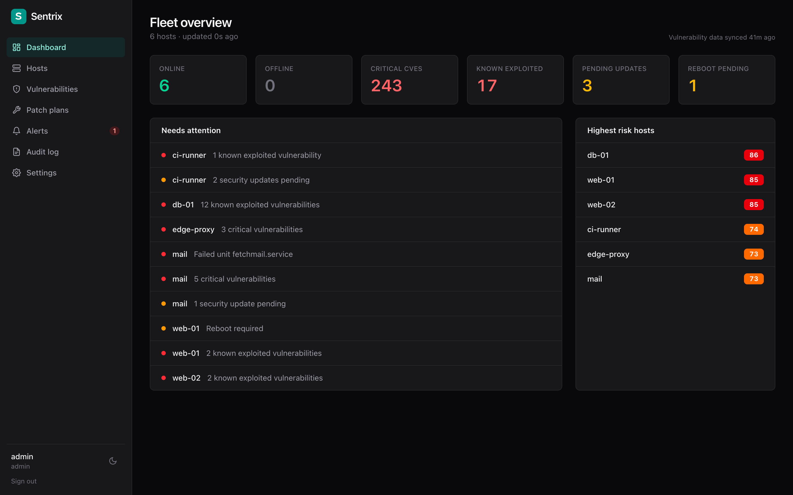
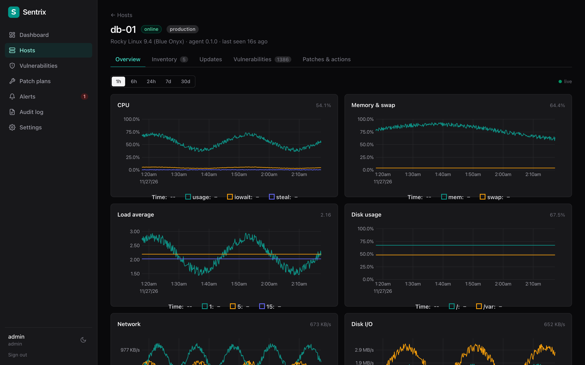
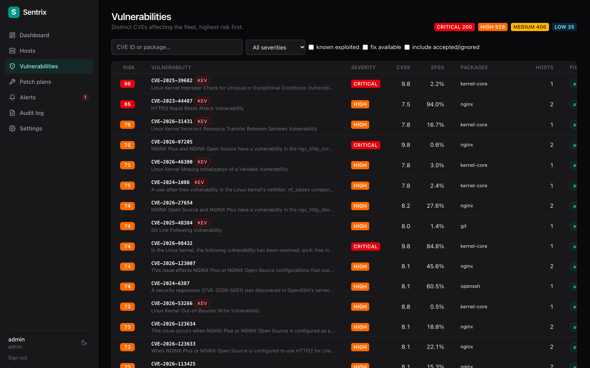
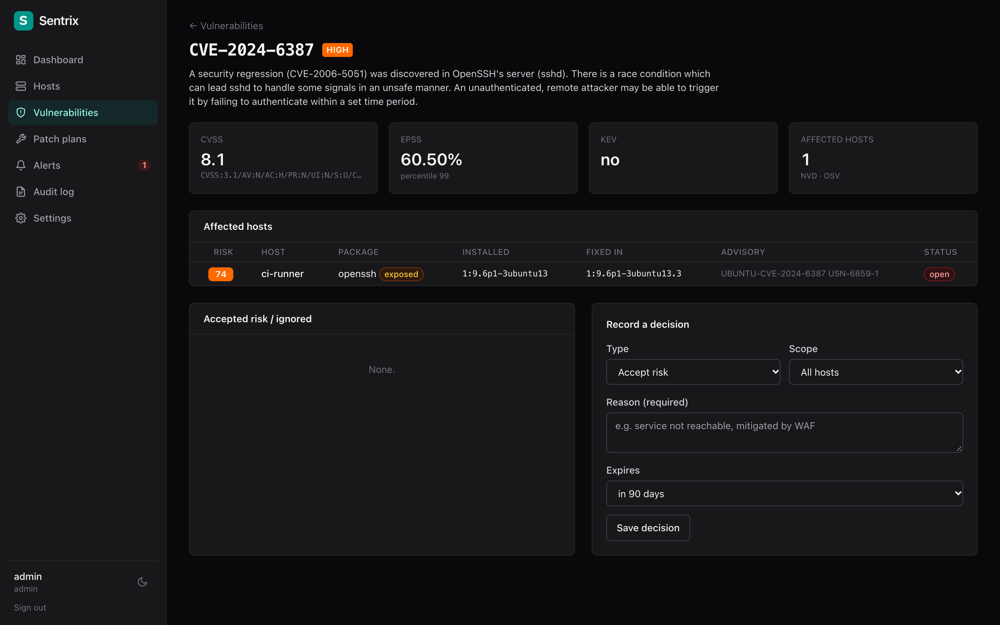
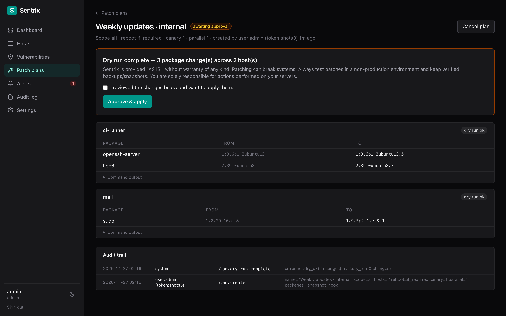

[Türkçe](README.md) · **English**

# Sentrix

**Self-hosted server health, CVE and patch management for small fleets** — by Varkhe Digital, Apache-2.0.

Sentrix watches your Linux servers (Proxmox VMs, VPSes, Dokploy hosts…), tells you which known
vulnerabilities affect each one and how urgent they really are, and patches them — on your command
or automatically inside maintenance windows you define. One small binary per host, one container
for the server.



> **Disclaimer.** Sentrix is provided "AS IS", without warranty of any kind. Patching can break systems.
> Always test patches in a non-production environment and keep verified backups/snapshots. You are solely
> responsible for actions performed on your servers.

## Features

- **Monitoring** — CPU (per core, iowait, steal), load, memory/swap, disk usage and inodes, disk I/O,
  network, processes, failed systemd units, watched services, Docker containers, pending reboot, TLS
  certificate expiry. Live charts (SSE), automatic rollups (10 s → 1 min → 1 h).
- **Inventory** — OS/kernel/virtualization, every installed package (dpkg, rpm, apk) with source packages,
  available updates with **security classification**, listening ports and their processes, container images.
- **Vulnerabilities** — Debian Security Tracker, OSV (Ubuntu, Alpine, Rocky, AlmaLinux), CISA KEV, FIRST EPSS,
  NVD. **Distro-aware matching** (backports respected, dpkg/RPM/apk version rules) done locally — no host
  data leaves your server. An explained **risk score** combines CVSS, EPSS, KEV, fix availability and network
  exposure. Per-host, per-CVE, per-package and fleet views; accept-risk/ignore with reason and expiry.
- **Patching** — plans with a mandatory **dry run** showing exact package changes per host, approval,
  **canary** rollout that stops on the first failure, reboot handling, post-patch verification; per-group
  **policies** (`notify_only` by default, `auto_security`, `auto_all`) with timezone-aware **maintenance windows**;
  **Proxmox VE snapshots** (or any webhook) before patching; full **audit log**.
- **Alerts** — thresholds, agent offline, failed/watched services, long-pending reboots, new KEV/critical CVEs,
  patch results → email, Telegram, Discord, Slack, ntfy, webhook. Dedup, cooldowns, resolve messages, daily digest.
- **Secure by design** — outbound-only agents with mutual TLS, **no remote shell** (closed set of typed
  actions), argon2id + TOTP 2FA, roles, scoped API tokens, CSRF protection, strict CSP, secrets encrypted at rest.
- **Turkish and English** — the UI language is chosen per user (picker in the sidebar, on the sign-in page and in
  *Account* settings); the server default is Turkish (`language: tr` / `SENTRIX_LANGUAGE=tr`). Notifications use the
  server default language; the CLIs follow `SENTRIX_LANGUAGE` (default `tr`).
- **Small** — agent: single static binary, ~14 MB RSS, < 0.1 % CPU at idle. Server: single binary + SQLite.

| | |
|---|---|
|  |  |
|  |  |

## Quick start

**1. Start the server** (Docker, works on Dokploy/Portainer too):

```bash
curl -fsSLO https://raw.githubusercontent.com/atillakurtulussimsek/Sentrix/main/docker-compose.yml
SENTRIX_HOST=sentrix.example.com docker compose up -d
```

Open `http://sentrix.example.com:8080`, create the admin account and accept the disclaimer.
Port **8443** is the agent gateway (mutual TLS, terminated by Sentrix — forward it as plain TCP).

**2. Create an enrolment token** — the setup wizard takes you to *Settings → Enrolment*
(headless: `docker compose exec sentrix sentrix-server token create`).

**3. Install the agent** on each server, as root, with the one-liner shown next to the token:

```bash
curl -fsSL http://sentrix.example.com:8080/install.sh | sudo sh -s -- --token sxe_… --ca-fingerprint 3f9c…
```

The installer accepts `--lang tr|en` (default `tr`). The host appears within seconds; its inventory and
vulnerabilities within a few minutes (the first feed download takes a moment). Supported: Debian 11/12/13, Ubuntu 22.04/24.04, Rocky/AlmaLinux 8/9 (+ Alpine,
Fedora for monitoring/inventory).

More: [installation](docs/install.md) (packages, systemd, TLS, reverse proxies) ·
[configuration](docs/configuration.md) · [architecture](docs/architecture.md) ·
[agent actions & security model](docs/agent-security.md) · [patch policies](docs/patch-policies.md) ·
[notifications](docs/notifications.md) · [Proxmox snapshots](docs/proxmox.md) · [FAQ](docs/faq.md) ·
[security policy](SECURITY.md).

## CLI

```bash
sentrix login --server https://sentrix.example.com --token sxa_…   # Settings → API tokens
sentrix cve list --severity high
sentrix patch plan --group production --scope security --canary 1   # shows the dry run
sentrix patch apply <plan-id> --approve
```

## Building from source

```bash
make build test lint        # Go 1.26+, golangci-lint v2
make run-server             # dev server on :18080 (deploy/dev/server.yaml)
go run ./test/tools/fakefleet   # simulated fleet for UI work
make css                    # rebuild Tailwind (Node.js; output is committed)
```

## Roadmap

- PostgreSQL backend (the storage layer is already SQL-portable)
- Red Hat OVAL/CSAF ingestion for RHEL itself; Fedora and SUSE vulnerability data
- Container image scanning (images are already inventoried)
- Windows Server and macOS agents
- Kubernetes node/workload view
- More UI languages
- Per-user notification preferences, on-call schedules

## License

Apache License 2.0 — Copyright Varkhe Digital. See [LICENSE](LICENSE) and [NOTICE](NOTICE).
