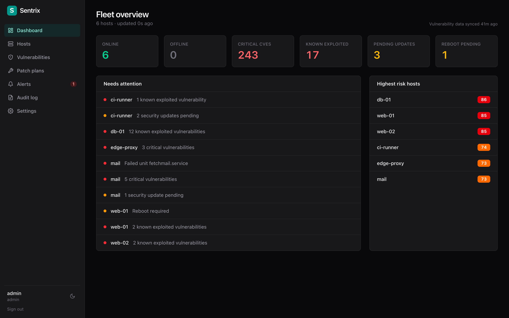
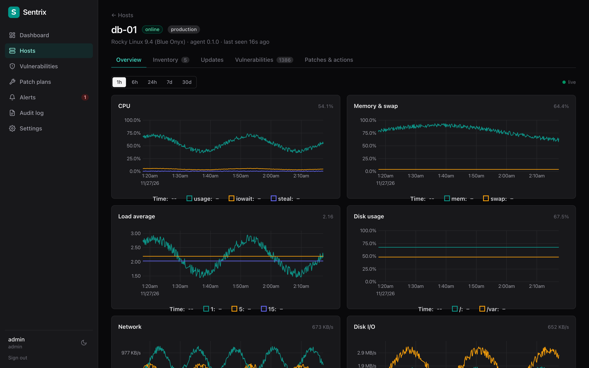
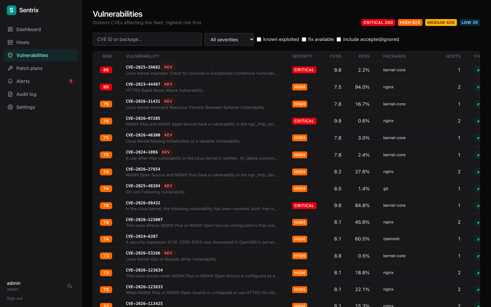
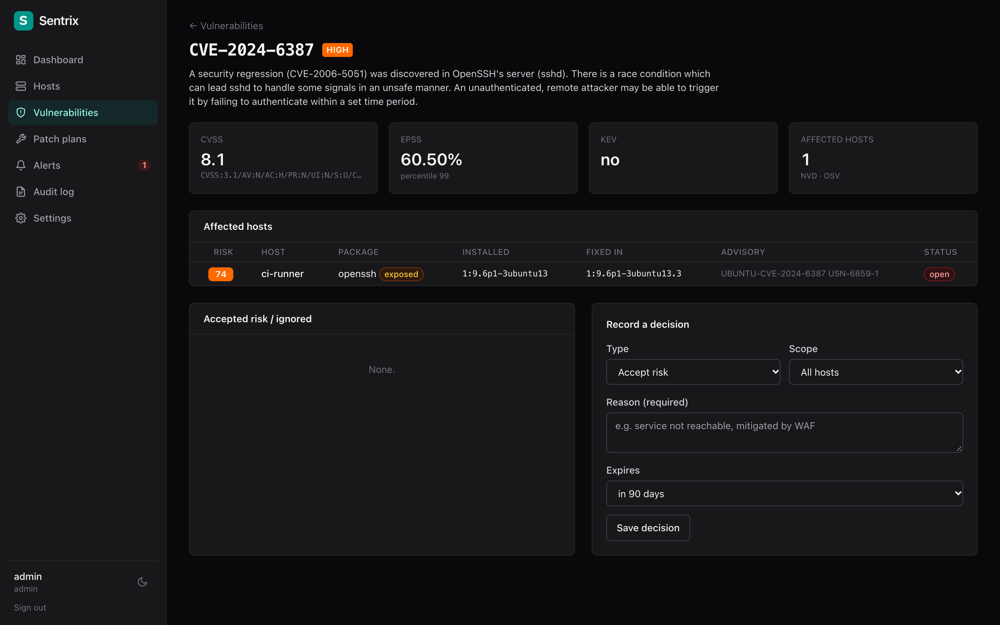
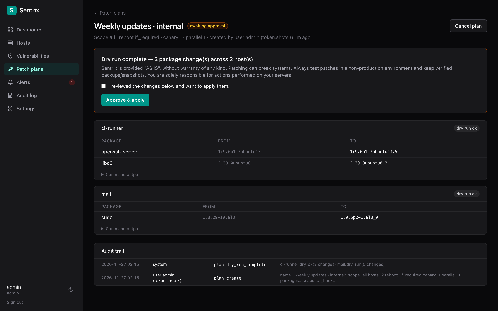

**Türkçe** · [English](README.en.md)

# Sentrix

**Küçük sunucu filoları için kendi sunucunuzda barındırılan sunucu sağlığı, CVE ve yama yönetimi** — Varkhe Digital, Apache-2.0.

Sentrix, Linux sunucularınızı (Proxmox sanal makineleri, VPS'ler, Dokploy sunucuları…) izler; her birini hangi
bilinen zafiyetlerin etkilediğini ve bunların gerçekte ne kadar acil olduğunu söyler ve onları yamalar — sizin
komutunuzla ya da tanımladığınız bakım pencereleri içinde otomatik olarak. Her sunucuda tek bir küçük ikili dosya,
sunucu tarafı için tek bir konteyner.



> **Sorumluluk reddi.** Sentrix "OLDUĞU GİBİ", hiçbir garanti olmaksızın sunulur. Yama uygulamak sistemleri bozabilir.
> Yamaları her zaman önce üretim dışı bir ortamda test edin ve doğrulanmış yedekler/anlık görüntüler bulundurun.
> Sunucularınızda gerçekleştirilen işlemlerden yalnızca siz sorumlusunuz.

## Özellikler

- **İzleme** — CPU (çekirdek başına, iowait, steal), yük, bellek/swap, disk kullanımı ve inode'lar, disk G/Ç,
  ağ, süreçler, başarısız systemd birimleri, izlenen servisler, Docker konteynerleri, bekleyen yeniden başlatma,
  TLS sertifikası bitiş tarihi. Canlı grafikler (SSE), otomatik özetleme (10 sn → 1 dk → 1 sa).
- **Envanter** — İşletim sistemi/çekirdek/sanallaştırma, kaynak paketleriyle birlikte kurulu tüm paketler (dpkg, rpm,
  apk), **güvenlik sınıflandırmalı** mevcut güncellemeler, dinlenen portlar ve bunları kullanan süreçler, konteyner imajları.
- **Zafiyetler** — Debian Security Tracker, OSV (Ubuntu, Alpine, Rocky, AlmaLinux), CISA KEV, FIRST EPSS, NVD.
  **Dağıtıma duyarlı eşleştirme** (backport'lar dikkate alınır, dpkg/RPM/apk sürüm kuralları) yerel olarak yapılır —
  hiçbir sunucu verisi sunucunuzun dışına çıkmaz. Açıklamalı bir **risk puanı**; CVSS, EPSS, KEV, düzeltme
  bulunabilirliği ve ağ maruziyetini birleştirir. Sunucu, CVE, paket ve filo bazında görünümler; gerekçe ve bitiş
  tarihiyle riski kabul etme/yok sayma.
- **Yamalama** — her sunucu için tam paket değişikliklerini gösteren zorunlu **deneme çalıştırması** içeren planlar,
  onay, ilk hatada duran **kanarya** dağıtımı, yeniden başlatma yönetimi, yama sonrası doğrulama; saat dilimine duyarlı
  **bakım pencereleri** ile grup bazında **politikalar** (varsayılan `notify_only`, `auto_security`, `auto_all`);
  yamadan önce **Proxmox VE anlık görüntüleri** (ya da herhangi bir webhook); eksiksiz **denetim kaydı**.
- **Alarmlar** — eşikler, çevrimdışı ajan, başarısız/izlenen servisler, uzun süredir bekleyen yeniden başlatmalar,
  yeni KEV/kritik CVE'ler, yama sonuçları → e-posta, Telegram, Discord, Slack, ntfy, webhook. Tekilleştirme, bekleme
  süreleri, çözüldü mesajları, günlük özet.
- **Tasarımdan güvenli** — yalnızca dışa doğru bağlanan, karşılıklı TLS kullanan ajanlar, **uzak kabuk yok**
  (kapalı bir tipli eylem kümesi), argon2id + TOTP 2FA, roller, kapsamlı API anahtarları, CSRF koruması, katı CSP,
  depolanan sırların şifrelenmesi.
- **Türkçe ve İngilizce** — arayüz dili kullanıcı başına seçilir (kenar çubuğundaki, giriş sayfasındaki ve
  *Hesap* ayarlarındaki seçici); sunucunun varsayılan dili Türkçedir (`language: tr` / `SENTRIX_LANGUAGE=tr`).
  Bildirimler sunucunun varsayılan dilini kullanır; komut satırı araçları `SENTRIX_LANGUAGE` değerini izler
  (varsayılan `tr`).
- **Küçük** — ajan: tek statik ikili dosya, ~14 MB RSS, boştayken < %0,1 CPU. Sunucu: tek ikili dosya + SQLite.

| | |
|---|---|
|  |  |
|  |  |

## Hızlı başlangıç

**1. Sunucuyu başlatın** (Docker; Dokploy/Portainer üzerinde de çalışır):

```bash
curl -fsSLO https://raw.githubusercontent.com/atillakurtulussimsek/Sentrix/main/docker-compose.yml
SENTRIX_HOST=sentrix.example.com docker compose up -d
```

`http://sentrix.example.com:8080` adresini açın, yönetici hesabını oluşturun ve sorumluluk reddini kabul edin.
**8443** numaralı port ajan geçididir (karşılıklı TLS, Sentrix tarafından sonlandırılır — bu portu düz TCP olarak
yönlendirin).

**2. Bir kayıt anahtarı oluşturun** — kurulum sihirbazı sizi *Ayarlar → Kayıt* sayfasına götürür
(arayüzsüz: `docker compose exec sentrix sentrix-server token create`).

**3. Ajanı kurun** — her sunucuda, root olarak, anahtarın yanında gösterilen tek satırlık komutla:

```bash
curl -fsSL http://sentrix.example.com:8080/install.sh | sudo sh -s -- --token sxe_… --ca-fingerprint 3f9c…
```

Kurulum betiği `--lang tr|en` seçeneğini kabul eder (varsayılan `tr`). Sunucu birkaç saniye içinde görünür;
envanteri ve zafiyetleri birkaç dakika içinde gelir (ilk veri kaynağı indirmesi biraz zaman alır). Desteklenenler:
Debian 11/12/13, Ubuntu 22.04/24.04, Rocky/AlmaLinux 8/9 (+ izleme/envanter için Alpine, Fedora).

Daha fazlası: [kurulum](docs/tr/install.md) (paketler, systemd, TLS, ters vekiller) ·
[yapılandırma](docs/tr/configuration.md) · [mimari](docs/tr/architecture.md) ·
[ajan eylemleri ve güvenlik modeli](docs/tr/agent-security.md) · [yama politikaları](docs/tr/patch-policies.md) ·
[bildirimler](docs/tr/notifications.md) · [Proxmox anlık görüntüleri](docs/tr/proxmox.md) · [SSS](docs/tr/faq.md) ·
[güvenlik politikası](SECURITY.tr.md).

## CLI

```bash
sentrix login --server https://sentrix.example.com --token sxa_…   # Settings → API tokens
sentrix cve list --severity high
sentrix patch plan --group production --scope security --canary 1   # shows the dry run
sentrix patch apply <plan-id> --approve
```

API anahtarını *Ayarlar → API anahtarları* sayfasından oluşturun. `patch plan` komutu deneme çalıştırmasının
sonucunu gösterir.

## Kaynaktan derleme

```bash
make build test lint        # Go 1.26+, golangci-lint v2
make run-server             # dev server on :18080 (deploy/dev/server.yaml)
go run ./test/tools/fakefleet   # simulated fleet for UI work
make css                    # rebuild Tailwind (Node.js; output is committed)
```

`make run-server` geliştirme sunucusunu :18080 portunda başlatır; `fakefleet` arayüz çalışmaları için benzetimli bir
filo sağlar; `make css` Tailwind stil dosyasını yeniden üretir (Node.js gerekir; çıktı depoya işlenir).

## Yol haritası

- PostgreSQL arka ucu (depolama katmanı zaten SQL açısından taşınabilir)
- RHEL'in kendisi için Red Hat OVAL/CSAF verilerinin işlenmesi; Fedora ve SUSE zafiyet verileri
- Konteyner imajı taraması (imajlar zaten envantere alınıyor)
- Windows Server ve macOS ajanları
- Kubernetes düğüm/iş yükü görünümü
- Daha fazla arayüz dili
- Kullanıcı başına bildirim tercihleri, nöbet çizelgeleri

## Lisans

Apache License 2.0 — Telif hakkı Varkhe Digital. Bkz. [LICENSE](LICENSE) ve [NOTICE](NOTICE).
